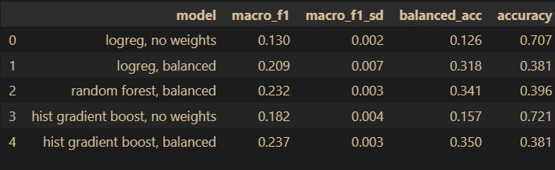
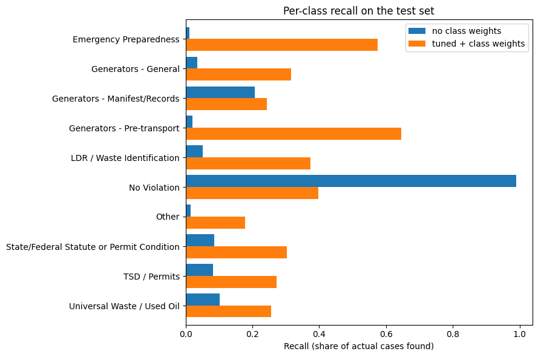
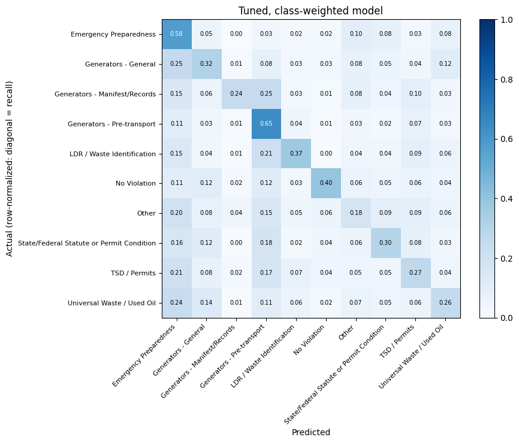
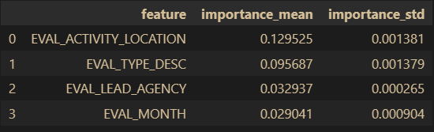

# RCRA Compliance Violation Class Prediction Model

A reproducible scikit-learn pipeline that predicts which **category of hazardous-waste (RCRA) violation** an EPA/state compliance evaluation will turn up, using only information known when the evaluation takes place.

This project is a reusable version of a machine learning homework I completed in the George Washington University MEng in AI/ML program. I rebuilt it by hand, with AI assistance, as an end-to-end template: raw data, preprocessing pipeline, cross-validation, tuning, test evaluation, feature importance and a saved model. The data comes from EPA ECHO (Enforcement and Compliance History Online), EPA's public compliance data warehouse (see [`data/README.md`](data/README.md)).

**Headline result:** a tuned, class-weighted HistGradientBoostingClassifier reaches a test **macro-F1 of 0.239**, compared with 0.187 for the same model without class weights and 0.083 for a majority-class baseline.

## Results

About 70.6% of evaluations are "No Violation," so a model that always guesses that class scores 0.706 accuracy while finding no violations at all. For that reason I judge models by macro-F1 and balanced accuracy, not accuracy alone. Task: 10 classes (9 violation groups plus "No Violation"). Stratified 70/30 split: 133,721 training and 57,309 test evaluations (`random_state=42`).

| Held-out test set | Macro-F1 | Balanced acc. | Accuracy |
|---|---|---|---|
| Majority-class baseline | 0.083 | 0.100 | 0.706 |
| HistGradientBoosting, no class weights | 0.187 | 0.160 | 0.722 |
| **HistGradientBoosting, tuned + class weights** | **0.239** | **0.356** | 0.383 |

I cross-validated (3-fold, stratified) three model families, with and without class weights, on the training set only:

| Candidate | Macro-F1 | Balanced acc. | Accuracy |
|---|---|---|---|
| Logistic regression, no weights | 0.130 | 0.126 | 0.707 |
| Logistic regression, balanced | 0.209 | 0.318 | 0.381 |
| Random forest, balanced | 0.232 | 0.341 | 0.396 |
| HistGradientBoosting, no weights | 0.182 | 0.157 | 0.721 |
| **HistGradientBoosting, balanced** | **0.237** | **0.350** | 0.381 |

Class weighting is what moves the score. Without it, the models mostly predict "No Violation." The random forest and HistGradientBoosting are close (0.232 vs. 0.237), so the choice between them is not decisive.

**Figure 1: Cross-validation comparison, weighted vs. unweighted**



Class weighting costs accuracy (0.722 to 0.383) and recall on "No Violation," but recall rises for the violation classes (Figure 2). 

**Figure 2: Per-class recall on the test set, weighted vs. unweighted**



**Figure 3: Normalized confusion matrix, tuned weighted model.** Rows are actual classes and columns are predicted classes.



<details><summary>Per-class test metrics (tuned model)</summary>

| Class | Precision | Recall | F1 | Support |
|---|---|---|---|---|
| Emergency Preparedness | 0.07 | 0.58 | 0.12 | 906 |
| Generators - General | 0.10 | 0.32 | 0.15 | 2,090 |
| Generators - Manifest/Records | 0.41 | 0.24 | 0.31 | 2,251 |
| Generators - Pre-transport | 0.17 | 0.65 | 0.27 | 2,257 |
| LDR / Waste Identification | 0.17 | 0.37 | 0.23 | 1,002 |
| No Violation | 0.97 | 0.40 | 0.57 | 40,460 |
| Other | 0.03 | 0.18 | 0.05 | 634 |
| State/Federal Statute or Permit Condition | 0.24 | 0.30 | 0.27 | 2,723 |
| TSD / Permits | 0.13 | 0.27 | 0.18 | 2,032 |
| Universal Waste / Used Oil | 0.24 | 0.26 | 0.25 | 2,954 |
| macro avg | 0.25 | 0.36 | 0.24 | 57,309 |
| weighted avg | 0.75 | 0.38 | 0.47 | 57,309 |

</details>

## What drives predictions

I used permutation importance on the fitted pipeline with the raw test features: shuffle one feature and measure the drop in macro-F1. Running it on the whole pipeline keeps all one-hot columns of a feature together as one unit. I used the test set because it measures what the model relies on for data it has not seen, whereas training-set importance can reward features the model merely memorized.

| Feature | Drop in macro-F1 |
|---|---|
| `EVAL_ACTIVITY_LOCATION` | 0.130 |
| `EVAL_TYPE_DESC` | 0.096 |
| `EVAL_LEAD_AGENCY` | 0.033 |
| `EVAL_MONTH` | 0.029 |

Shuffling `EVAL_ACTIVITY_LOCATION` lowers test macro-F1 by about 0.13, the largest drop of any feature, so the model relies on it most. These are associations in the data, not causes.

**Figure 4: Permutation importance**



## Design decisions

| Step | Choice | Reason |
|---|---|---|
| Unit of analysis | One row per evaluation (`ISN_RCR_EVAL`) | The raw file has one row per violation, but the model must score evaluations. |
| Label | About 121 CFR citation codes grouped into 9 regulatory families plus "No Violation." If an evaluation has several groups, the group with the most distinct violation types wins, and ties go to the rarer group. | Keeps classes meaningful and stops rare classes being swallowed. |
| Time window | Evaluations from 2017 onward; drop evaluations on/after `LABEL_LAG_CUTOFF` (2026-09-01) | Current regulations. Recent evaluations may not have violations determined yet and would look falsely clean. |
| Features | Evaluation type, lead agency, activity location, month | Columns known only after the evaluation (violation and return-to-compliance dates, enforcement actions, penalties, the found-violation flag) are dropped as target leakage. |
| Preprocessing | `ColumnTransformer`: impute and one-hot encode categoricals (rare and unseen categories handled); impute and min-max scale the numeric month | Inside a `Pipeline`, so it is re-fit on each CV fold and nothing from validation or test rows leaks in. |
| Class imbalance | `class_weight="balanced"` | No resampling of validation data. |
| Tuning | `RandomizedSearchCV`, 3 iterations, 3-fold stratified CV, scored on macro-F1 | Macro-F1 weights every class equally. |
| Evaluation | Test set used once; macro-F1, balanced accuracy, per-class precision/recall/F1, normalized confusion matrix | Honest under imbalance. |
| Saved model | `joblib` file holding the whole pipeline, the label encoder, the feature list and the scikit-learn version | New raw rows can be scored directly, and the version is recorded. |

**Preprocessing and imputation warning.** The pipeline fills missing values (most frequent value for categoricals, median for numerics). In this dataset, the four model features had no missing values after cleaning, so imputation did nothing here. On a new dataset it could matter a lot. Check for missing values *before* trusting the defaults. If missingness carries meaning (common in environmental compliance data, where a blank field can mean "no action taken"), do not fill it silently: keep it as its own category or add a missing-value indicator. Never impute the target label. Document the choice and compare results with and without imputation.

**Reusing this as a template.** Part 2 of the notebook (split, preprocessing, cross-validation, tuning, evaluation, importance, save) is driven by the settings cell (`TARGET`, `CAT_FEATURES`, `NUM_FEATURES`) and works for any tabular multi-class problem. Part 1 (data preparation) is specific to RCRA and would be rewritten for another dataset.

## Limitations

- **Modest signal.** Four pre-evaluation features give a macro-F1 of 0.239. That is a real gain over the baselines, but it is not a standalone decision tool. Treat the output as a prioritization signal.
- **Low precision for rare classes** (for example Emergency Preparedness at 0.07). Many predicted violations will not occur. "No Violation" has recall 0.40 at precision 0.97, so the model is deliberately cautious, which is the price of class weighting.
- **Tuning was light.** The search ran only 3 iterations, and its best cross-validated score (0.2341) did not beat the default HistGradientBoosting score (0.237). The limit looks like feature information, not hyperparameters.
- **Random split.** A time-based split, training on earlier years and testing on later ones, is the stricter test of forward-looking performance and is not included.
- **Labeling choices.** The violation-group mapping and the tie-break rule are my own design decisions and change the target.
- **Observational data.** Inspection targeting itself shapes which violations get recorded. Not for individual enforcement decisions without human review.

## Next steps

1. **Facility-history features** (prior violations, days since last inspection, generator status), computed strictly from records *before* each evaluation date. This is the most likely source of a large gain.
2. Time-based validation split.
3. A larger hyperparameter search (more than 3 iterations).
4. SHAP explanations and an XGBoost candidate.
5. Probability calibration and per-class decision thresholds.
6. Apply the modeling half to another ECHO program (for example Clean Water Act / stormwater data) by rewriting the data-preparation step.

## How to reproduce

Tested on Python 3.11.9 with the pinned versions in `requirements.txt`.

```bash
git clone https://github.com/RealData360/rcra-violation-prediction-model.git
cd rcra-violation-prediction-model
python -m venv .venv && source .venv/bin/activate   # Windows: .venv\Scripts\activate
pip install -r requirements.txt
```

1. Download the RCRA data file from EPA ECHO and place it in `data/` as described in [`data/README.md`](data/README.md).
2. Start JupyterLab and open `RCRA_Compliance_Violation_Prediction_Model.ipynb`.
3. Run **Restart Kernel and Run All Cells**. Runtime: The tuning step is the slowest part.

Results are fixed by the random seeds (`RANDOM_STATE = 42`) and the pinned package versions; a different data download may give different numbers. Figures are written to `figures/` and the fitted model to `models/champion.joblib` (not tracked in git).

To score new evaluations with the saved model:

```python
import joblib
art = joblib.load("models/champion.joblib")
pipe, le = art["pipeline"], art["label_encoder"]
labels = le.inverse_transform(pipe.predict(new_df[art["features"]]))
```

`new_df` needs the columns `EVAL_TYPE_DESC`, `EVAL_LEAD_AGENCY`, `EVAL_ACTIVITY_LOCATION` and `EVAL_MONTH`. Load it with the same scikit-learn version recorded in the file (`art["sklearn_version"]`).

## Data source

U.S. EPA ECHO, RCRA data downloads (https://echo.epa.gov/tools/data-downloads). Public data; this project is independent and not affiliated with or endorsed by EPA.

## AI Assistance
I wrote and ran the notebook code myself. I used Claude clean up code formatting, as a tutor and reviewer for explanations and debugging, and to help draft and edit parts of this README. I am responsible for the content.

## Author and license

Built by Terrence Hodges as part of the GWU MEng in AI/ML program. Released under the MIT License.

